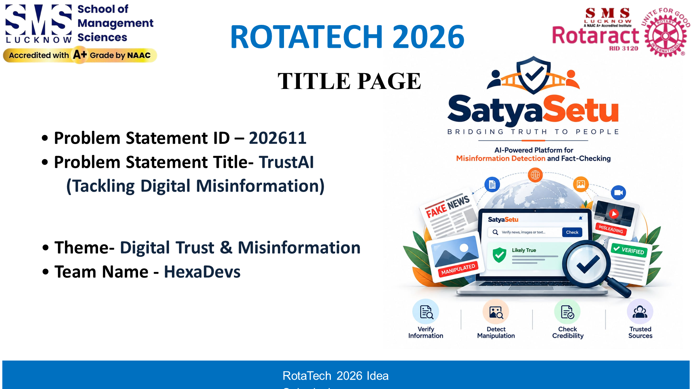

# Speaker 1: Anshika Pandey (Team Leader & Lead Anchor)
**Slide 1: TITLE PAGE & EXECUTIVE OVERVIEW**  
**Role**: Team Leader & Lead Presenter  
**Speaking Time**: `0:00 – 0:45` (~45 Seconds)  
**3-Word Memory Anchor**: **Pension Scam ➔ 500M People ➔ SatyaSetu**

---

## Your Slide Screenshot

---

## What is on Your Slide (Visual Reference)
- **Top Header**: ROTATECH 2026 | SatyaSetu (सत्यसेतु)
- **Problem Statement ID**: 202611
- **Problem Statement Title**: TrustAI: Tackling Digital Misinformation
- **Theme**: Digital Trust & Misinformation
- **Team Name**: HexaDevs / SatyaSetu
- **Team Roster**: All 5 members with roles and operational split

---

## Exact Simple Words to Say (Memorize This)

> "Respected judges, imagine an elderly grandfather in a small village.
> 
> He gets a forwarded WhatsApp message:  
> *'URGENT: Free Government Laptop Scheme ends tonight. Click here to register.'*
> 
> Wanting to help his granddaughter study, he clicks the link, types his bank details, and within five minutes, all his pension savings are stolen.
> 
> This does not happen once in a while. It happens every single day to over **500 million WhatsApp users** across India.
> 
> People fall for it because nobody reads long news articles before forwarding. And standard AI chatbots often make up fake facts.
> 
> That is why we built **SatyaSetu**. It is a simple, zero-lie verification tool that gives instant, bilingual truth cards right where rumors spread.
> 
> To explain how fake news spreads and how we stop it, here is **Suryansh**."

---

## Your Handoff Cue (Say Loudly & Clearly)
> *"To explain how fake news spreads and how we stop it, here is Suryansh."*

---

## Your Role in Jury Q&A (Lead Dispatcher)
1. **Rule**: You catch every single question from the judges first!
2. **Anchor Phrase (3 seconds)**:  
   *"Thank you, sir/ma'am. That is an essential question regarding our [accuracy / speed / adoption]."*
3. **Dispatch**:
   - If about **AI bias / fake answers** ➔ *"Suryansh, please explain our zero-guessing policy."*
   - If about **speed / servers** ➔ *"Srijan, explain our 15ms cache."*
   - If about **fact-checker truth** ➔ *"Amit, explain our verified government sources."*
   - If about **village adoption** ➔ *"Akhilesh, explain our 1-to-256 group sharing model."*
   - If about **privacy / data theft** ➔ Answer directly: *"We store zero phone numbers, zero chats, and zero personal data. It is 100% anonymous."*
