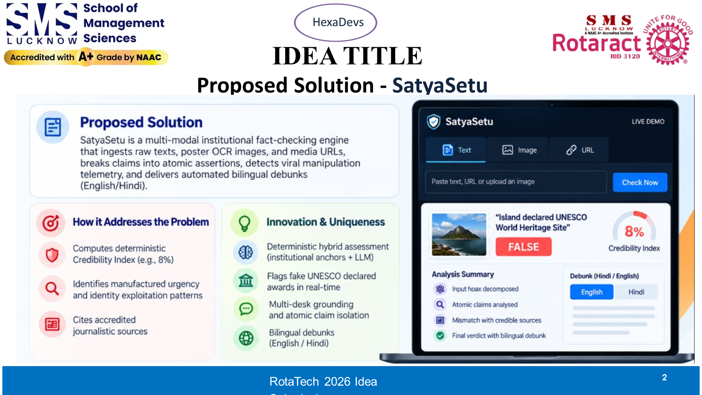

# Speaker 2: Suryansh Pandey (AI Vision & Multimodal Lead)
**Slide 2: IDEA TITLE & PROPOSED SOLUTION**  
**Role**: AI Vision & Multimodal Lead  
**Speaking Time**: `0:45 – 1:30` (~45 Seconds)  
**3-Word Memory Anchor**: **Fake Panic ➔ Read Screenshot ➔ Truth Card**

---

## Your Slide Screenshot

---

## What is on Your Slide (Visual Reference)
- **Top Header**: Proposed Solution - SatyaSetu (Dual-Circuit Architecture)
- **Top Diagram**: Anatomy of a Viral Rumor (Fabricated Claim ➔ Manufactured Urgency ➔ Zero Source Anchors ➔ Blind Panic Forwarding)
- **Bottom 4 Solution Pillars**:
  1. Multimodal OCR & Image Cleaning (OpenCV)
  2. Certified Fact Checks (PIB, AltNews, BOOM Live)
  3. Deception Gauges (Urgency %, Outrage %, Missing Circulars %)
  4. 1-Click Bilingual Rebuttal Cards (Hindi & English)

---

## Exact Simple Words to Say (Memorize This)

> "Thank you, Anshika. On Slide 2, you can see how rumors trick people.
> 
> A scammer writes a scary message with fake urgency like *'Forward to 10 people immediately'*, with zero official links. People panic and forward it blindly.
> 
> **SatyaSetu stops this in four simple steps**:
> 
> 1. **Reads Any Screenshot**: Users don't type text. They just send blurry WhatsApp screenshots. Our tool cleans the image and reads the text instantly.
> 2. **Checks Real Fact-Checkers**: We search verified organizations like PIB Fact Check, AltNews, and BOOM Live in less than a second.
> 3. **Measures the Danger**: Our meters show how much fake urgency and emotional drama is inside the message.
> 4. **Makes a 1-Click Truth Card**: We create a polite card in Hindi and English. Users can paste it straight back into their family groups to calm everyone down.
> 
> To explain our backend technology, here is our architect, **Srijan**."

---

## Your Handoff Cue (Say Loudly & Clearly)
> *"To explain our backend technology, here is our architect, Srijan."*

---

## Your Jury Q&A Questions to Defend
- **Judge: "How do you read low quality or forwarded images?"**  
  *Your Answer*: "We use OpenCV to clean image noise, fix contrast with Otsu thresholding, and run fast OCR. It handles compressed screenshots easily."
- **Judge: "What are those deception meters on the screen?"**  
  *Your Answer*: "They detect manipulative language—specifically artificial urgency words like 'Forward tonight' and missing official circular numbers."
