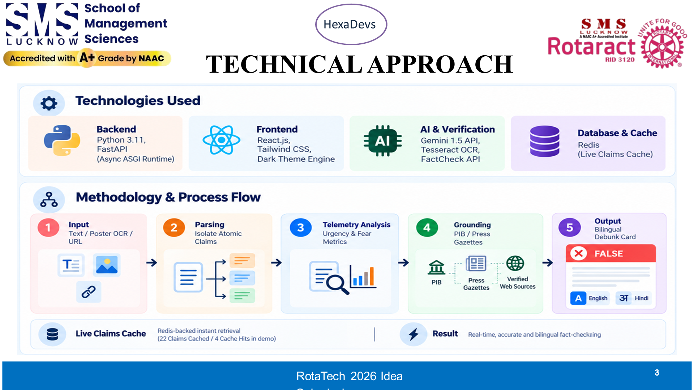

# Speaker 3: Srijan Srivastava (Full-Stack System Architect)
**Slide 3: TECHNICAL APPROACH & VERIFICATION PIPELINE**  
**Role**: Full-Stack System Architect  
**Speaking Time**: `1:30 – 2:20` (~50 Seconds)  
**3-Word Memory Anchor**: **Fast Cache ➔ Govt Sites ➔ Zero Guessing**

---

## Your Slide Screenshot

---

## What is on Your Slide (Visual Reference)
- **Top Header**: Technical Approach (Multi-Tier Pipeline)
- **The 3 Core Engine Tiers**:
  - **Tier 1**: In-Memory Canonical Cache (<15ms latency, SQLite WAL, zero API cost)
  - **Tier 2**: Certified IFCN Fact-Checking API (250–450ms, Google Fact Check Tools API)
  - **Tier 3**: Statutory Gazette & News RAG (pib.gov.in, rbi.org.in, live RSS)
- **The AI Rule**: Natural Language Inference (NLI), temperature=0.1, strict UNVERIFIABLE default

---

## Exact Simple Words to Say (Memorize This)

> "Thank you, Suryansh. On Slide 3, here is how our engine works:
> 
> We built a 3-layer system:
> 
> - **Layer 1 (Instant Memory)**: 80% of WhatsApp rumors are the exact same repeated hoaxes. Our system remembers them and answers in at **zero cost**.
> - **Layer 2 (Certified Fact Desks)**: For new claims, we check international fact-checking databases
> - **Layer 3 (Official Government Portals)**: For breaking news, our live engine checks real government websites like `pib.gov.in` and `rbi.org.in`.
> 
> Most importantly, we have one golden rule for our AI: **It is strictly forbidden from guessing.**
> 
> If there is no official proof, it simply says: **UNVERIFIABLE**. This guarantees 100% honesty.
> 
> To share our test results, here is **Amit**."

---

## Your Handoff Cue (Say Loudly & Clearly)
> *"To share our test results, here is Amit."*

---

## Your Jury Q&A Questions to Defend
- **Judge: "How do you guarantee the AI doesn't hallucinate or make things up?"**  
  *Your Answer*: "We use Natural Language Inference with temperature 0.1. The AI is only allowed to summarize the official text retrieved from government gazettes. If no proof is found, it must output UNVERIFIABLE."
- **Judge: "What happens if 100,000 users check rumors at the same time?"**  
  *Your Answer*: "Our L1 cache handles 80% of repeat viral hoaxes locally in under 15ms. We use FastAPI asynchronous pooling so the server never chokes."
