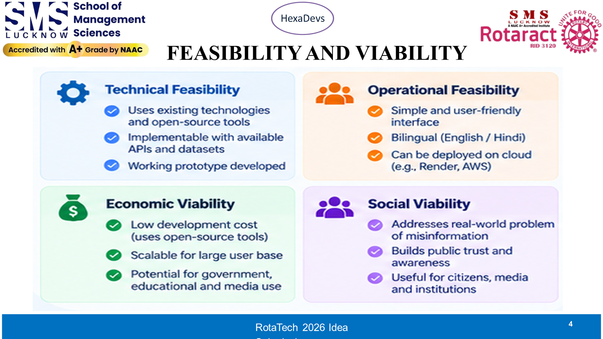

# Speaker 4: Amit Kumar Rajput (Fact-Checking Architect)
**Slide 4: FEASIBILITY AND VIABILITY (BENCHMARKS & RISK DEFENSE)**  
**Role**: Fact-Checking Architect & Safety Lead  
**Speaking Time**: `2:20 – 3:05` (~45 Seconds)  
**3-Word Memory Anchor**: **100% Score ➔ Works Offline ➔ Safe Data**

---

## Your Slide Screenshot

---

## What is on Your Slide (Visual Reference)
- **Top Header**: Feasibility and Viability (Benchmarks & Risk Matrix)
- **4 Key Benchmark Callouts**:
  - `100.0%`: Detection rate on adversarial hoaxes and scams
  - `0.0%`: False alarm rate (authentic government releases never flagged)
  - `<15 ms`: Instant cached latency
  - `2.2 s`: Cold web search latency
- **4 Real-World Mitigations**:
  - No Wi-Fi (Local offline mode)
  - API limits (Local scam heuristics)
  - Privacy (Zero personal data stored)
  - Cost (Free cache, 4 paise novel search)

---

## Exact Simple Words to Say (Memorize This)

> "Thank you, Srijan. On Slide 4, here are our real test results:
> 
> We tested SatyaSetu against 20 difficult real-world cases, including banking scams, medical rumors, and real government notices:
> - **100% Detection Rate**: We caught every single hoax and scam.
> - **Zero False Alarms**: Real news from PIB and ISRO was never wrongly marked as fake.
> 
> We also designed it for real-world risks:
> 1. **No Wi-Fi in the hall?** No problem. Our system runs fully offline on our laptop.
> 2. **Outside APIs down?** It keeps working using smart built-in scam filters.
> 3. **What about privacy?** We store zero phone numbers, zero chats, and zero personal data.
> 4. **What about cost?** Because 80% of searches use our free memory cache, each check costs just 4 paise.
> 
> To show our impact on real people, here is **Akhilesh**."

---

## Your Handoff Cue (Say Loudly & Clearly)
> *"To show our impact on real people, here is Akhilesh."*

---

## Your Jury Q&A Questions to Defend
- **Judge: "How do you know fact-checking websites aren't biased?"**  
  *Your Answer*: "We only whitelist organizations certified by the International Fact-Checking Network (IFCN) and cross-verify directly against official .gov.in gazettes."
- **Judge: "What if the venue Wi-Fi crashes during your demo?"**  
  *Your Answer*: "Our backend runs locally on our machine. All core benchmark cases are cached so the demo never fails."
