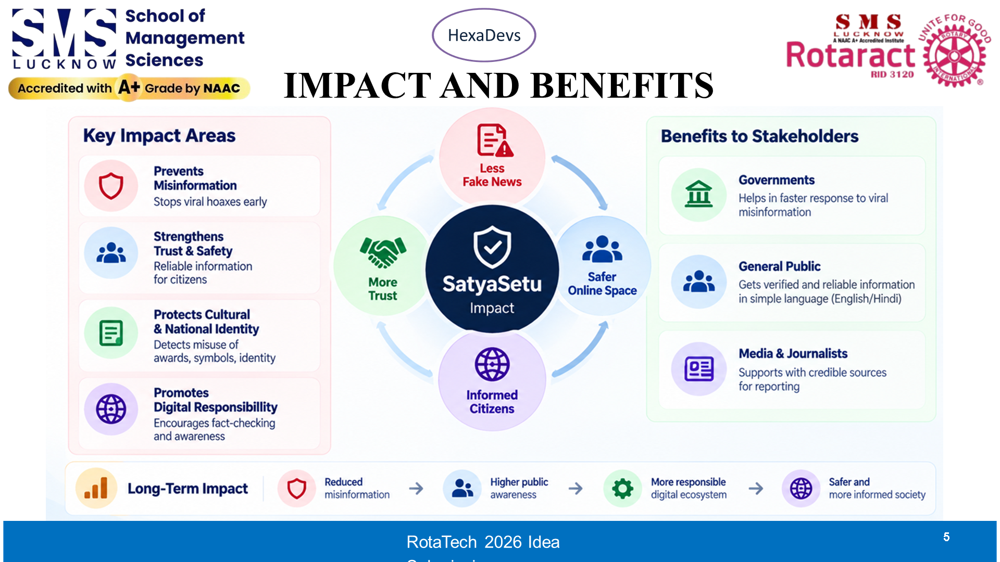
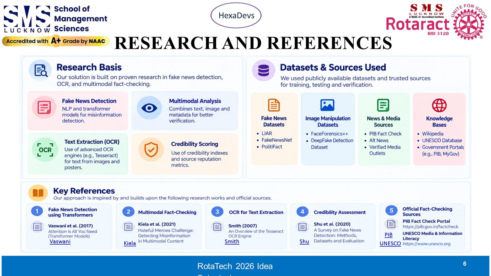

# Speaker 5: Akhilesh Sharma (Frontend & UI Lead)
**Slides 5 & 6: IMPACT AND BENEFITS, RESEARCH & REFERENCES**  
**Role**: Frontend & UI Lead  
**Speaking Time**: `3:05 – 3:55` (~50 Seconds)  
**3-Word Memory Anchor**: **Senior Citizens ➔ 1-to-256 Loop ➔ Real Truth**

---

## Your Slide Screenshots

### Slide 5: Impact and Benefits

### Slide 6: Research and References

---

## What is on Your Slides (Visual Reference)
- **Slide 5**:
  - **3 Target Personas**: Rural Citizens, Elderly Pensioners, WhatsApp Admins
  - **The 1-to-256 Viral Distribution Loop**: 1 check ➔ 1 truth card shared ➔ 255 people educated simultaneously
  - **Channels**: Live Web App, Chrome Extension, Phase 2 WhatsApp Helpline
- **Slide 6**:
  - **Verified Government Sources**: PIB, RBI, CBSE, UNESCO
  - **Standards**: Poynter IFCN, Schema.org ClaimReview, FEVER benchmark

---

## Exact Simple Words to Say (Memorize This)

> "Thank you, Amit. Slide 5 shows who SatyaSetu protects:
> - **Rural Citizens** who only use WhatsApp.
> - **Senior Citizens** targeted by fake power-cut warnings and pension frauds.
> - **Family Group Admins** who want polite facts to stop arguments.
> 
> Now look at our **1-to-256 Viral Loop**:
> When one person checks a rumor and pastes our truth card back into their 256-person group, **one single check protects 255 people at the same time!**
> 
> Our web app and Chrome extension are live right now. Next, we are launching our direct WhatsApp helpline number.
> 
> *(Looking at Slide 6)*: Everything we do is backed by verified standards from PIB, RBI, and international fact-checking guidelines.
> 
> Fake news spreads fast because it plays with fear. With SatyaSetu, the truth is finally faster, easier, and free for everyone.
> 
> We are Team HexaDevs. Thank you!"

---

## Your Closing Cue (Say Loudly & Clearly)
> *"We are Team HexaDevs. Thank you, and we are ready for your questions!"*

---

## Your Jury Q&A Questions to Defend
- **Judge: "How do you get non-tech villagers to use this?"**  
  *Your Answer*: "They don't have to download any heavy app. Whenever someone checks a rumor, they share our simple Hindi truth card back into their WhatsApp group. One person educates 255 people."
- **Judge: "Why will users trust your truth card?"**  
  *Your Answer*: "Because the card is polite, non-political, and shows the official government circular link right on the card."
